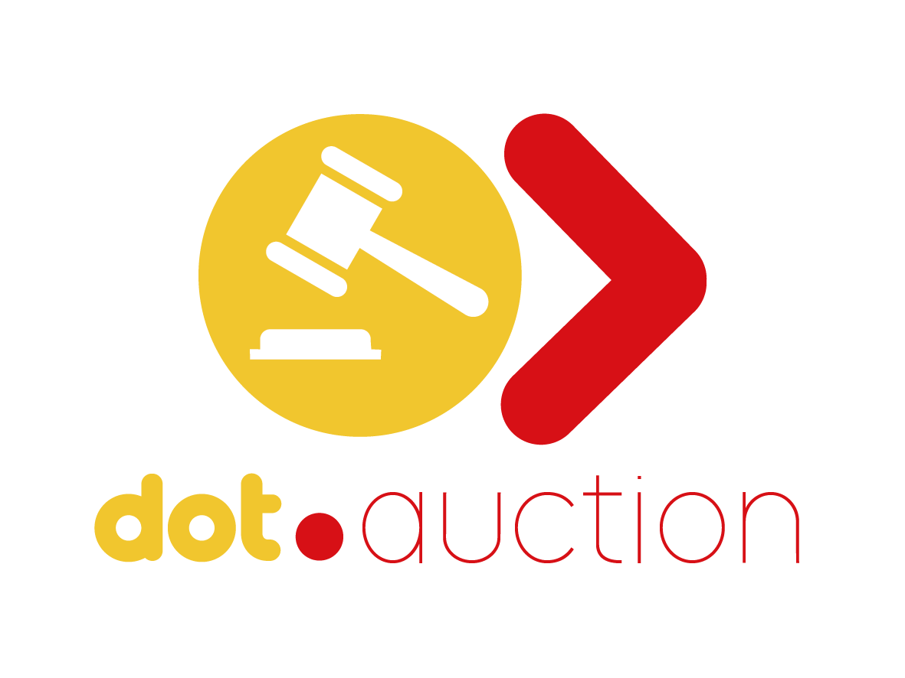

<div align="center">



<br /><br />

**List items, place live bids, and win with confidence.**

<br />

   

<br /><br />

**Part of the [Dot Ecosystem](https://github.com/sakhileb/InfoDot)** &nbsp;·&nbsp; `auction.infodot.app`

</div>

---

## What is Dot.Auction?

Dot.Auction is the live-bidding platform in the Dot ecosystem. Sellers list items with a starting
price and a fixed auction window; buyers browse, watch, and bid in real time, with automatic
highest-bid tracking and reserve-price confidentiality.

**Status:** built and running as a Laravel application. See [`wiki.md`](wiki.md) for the full,
kept-honest breakdown of what's actually implemented vs. still roadmap.

## Core Features (implemented today)

- Real auction schema: auctions, bids, categories, watchlist, and auction items
- Live bid broadcasting via Laravel Reverb (`App\Events\BidPlaced` on `auction.{id}`)
- Seller operations dashboard — active lots, bids received, categories, watchlist volume, and an
  "ending soon" widget
- Buyer-facing marketplace: search/filter auctions by title, category, and status (`/auctions`)
- Auction detail + live bidding page (`/auctions/{auction}`), including the previously
  unrendered `BidPanel` Livewire component
- Reserve-price confidentiality: buyer-facing views only ever see "reserve met / not met" — the
  actual reserve amount is never sent to a non-seller
- Buyer watchlist toggle (add/remove an auction from your watchlist)
- In-app notification bell (Laravel's `database` notification channel); an outbid notification
  fires automatically the moment someone else outbids you
- Dark / light mode toggle (Tailwind class-based strategy, persisted per browser)
- Ecosystem SSO from the Dot hub

> **Not yet built:** auto-bid execution (the `is_auto_bid` column exists, no engine acts on it),
> an auction settlement job (nothing flips `status` to `ended` automatically when `ends_at`
> passes), dispute resolution, and the Knowledge Pack publisher to Dot.Brain.
> `AuctionWonNotification` and `AuctionEndingSoonNotification` classes exist but have no
> automatic trigger yet — they're ready for the settlement job / scheduled sweep once those
> exist. See `wiki.md` §6 for the full roadmap. Earlier drafts of this README described
> fictitious models (`AuctionLot`, `AuctionResult`) that were never implemented — the real
> domain models are listed below.

## Domain Models

- **Auction** — item/lot listed for bidding, with starting/reserve/current/buy-now price and a
  status lifecycle (`draft` → `active` → `ended`/`cancelled`)
- **Bid** — placed bid with amount, `is_winning` flag, and `is_auto_bid` flag (unused today)
- **AuctionCategory** — simple taxonomy
- **Watchlist** — buyer-side interest tracker (`user_id` + `auction_id`)
- **AuctionItem** — item-level detail attached to an auction (condition, location)

## Tech Stack

| Layer | Technology |
|---|---|
| Framework | Laravel 12 |
| Language | PHP 8.4 |
| Frontend | Livewire 3 · Alpine.js 3 · Tailwind CSS |
| Database | PostgreSQL 16 (shared `infodot` database across the ecosystem) |
| Realtime | Laravel Reverb (bid broadcasting) |
| Auth | Laravel Jetstream + Sanctum, team-based accounts (InfoDot SSO) |
| AI | Anthropic Claude (`ANTHROPIC_API_KEY`, `claude-sonnet-4-6`) — config only, not called by any auction logic yet |
| Queue | Database-backed queue |

## Quick Start

```bash
git clone https://github.com/sakhileb/Dot.Auction.git
cd Dot.Auction
cp .env.example .env
composer install
npm install && npm run build
php artisan key:generate
php artisan migrate
php artisan serve
```

> **Ecosystem SSO:** Set `DB_*` env vars to the shared InfoDot PostgreSQL instance and
> `APP_URL=https://auction.infodot.app`. Users authenticated through InfoDot gain access
> automatically via the Sanctum handoff at `/auth/ecosystem`.

### Running Tests

```bash
php artisan test
```

Feature tests use an in-memory SQLite connection (see `phpunit.xml`) and Laravel's
`RefreshDatabase` trait — no shared Postgres instance required to run them.

## Email via Dot.Notify

The in-app notifications this app already creates are also posted, server to server, to Dot.Notify
(`POST {NOTIFY_INGEST_URL}`, signed with HMAC-SHA256 over `"{timestamp}.{raw body}"` using
`NOTIFY_INGEST_SECRET`, headers `X-InfoDot-Timestamp` and `X-InfoDot-Signature`). Same trigger, same
recipient as the in-app notification; nothing about who is notified in-app changes.

| Event | Sent to | `data` keys |
|---|---|---|
| `auction.outbid` | the displaced bidder (also after Buy Now) | `auction_title`, `your_bid`, `current_price`, `currency`, `ends_at`, `url` |
| `auction.won` | the winner (settlement, or the seller accepting a reserve-not-met bid) | `auction_title`, `final_price`, `currency`, `url` |
| `auction.sold` | the seller, when the settlement is recorded | `auction_title`, `final_price`, `currency`, `status`, `url` |
| `auction.ending_soon` | each watcher, once (`auction:notify-ending-soon`) | `auction_title`, `current_price`, `currency`, `ends_at`, `url` |

Money is a string with two decimals and no separators (`"1234.50"`), the currency code
(`AUCTION_CURRENCY_CODE`) is separate, `ends_at` is ISO 8601, `url` is an absolute `https` link to the
auction page in this app. The email address is only ever in `recipient.email`; no other person's
address, no bidder names, no payment details are sent. `auction.sold.status` is `sold` for a new
settlement (awaiting payment).

**What it takes for an email to go out:** nothing is sent until `NOTIFY_INGEST_URL` **and**
`NOTIFY_INGEST_SECRET` are both set, **and** the recipient's company has enabled the event in Dot.Notify
(otherwise Notify answers `no_rule` and sends nothing). A **queue worker is required**
(`php artisan queue:work`): events are queued after the surrounding database transaction commits, so a
bid or settlement that rolls back sends nothing, and nothing is ever posted inside the user's request.

**Who is skipped:** Notify routes by company, so the recipient's company is their current team's
`infodot_team_uuid`, or their personal team's if the current team has none. A recipient with no
`infodot_team_uuid` (not provisioned from InfoDot) or no email is skipped, silently apart from an
info log line (event name and user id, never an address). The in-app notification is unaffected.

**Safety:** a Notify outage or misconfiguration cannot break or slow a bid, a settlement or the
ending-soon sweep. The job has a 5 second HTTP timeout, 3 tries with backoff, never throws, logs without
secrets or email addresses, and a small cache-based circuit breaker pauses calls for 60 seconds after
5 consecutive failures (jobs wait and retry; if Notify stays down they are dropped after their
third try, since a late email is not worth a growing queue). Retries and double dispatches share an
idempotency key, `"{event}:{auction id}:{sha1(recipient email)}:{bid id | settlement id}"`, so Notify
collapses them.

## Paying for a won auction (Paystack, test mode)

A sold auction records a settlement (`auction_settlements`, amount in integer cents). With Paystack
configured, the **winner** pays the winning amount from a "Pay now" button, and the sale becomes
**paid** once Paystack confirms it. **TEST MODE ONLY**: use `sk_test_` keys. With no key set nothing
changes: settlements stay "awaiting payment" with the original honest message, and nothing breaks.

> **What this is not.** The winner pays **Dot.Auction's own Paystack account**; the money lands in the
> platform's Paystack balance. **Seller payouts, commissions and fees, split payments, KYC, refunds
> and cards on file are not built** (they need compliance and finance decisions). The seller is told,
> everywhere, "payout is not available yet &mdash; payment received, settlement to seller is manual".
> Nothing in the app implies a seller has been paid.

### Setup

1. In the Paystack dashboard switch to **Test mode** and copy the test secret and public keys.
2. Set in `.env` (see the table below): `PAYSTACK_SECRET_KEY=sk_test_...`, `PAYSTACK_PUBLIC_KEY=pk_test_...`.
3. In the dashboard (Settings, API Keys & Webhooks, Test Webhook URL) enter `https://<your host>/webhooks/paystack`.
   The callback URL is sent per payment (`/settlements/{id}/payment/callback`) and needs no dashboard setting.
4. Make sure the scheduler runs (`* * * * * php artisan schedule:run`): it runs the 15-minute payment-deadline job.
5. One Paystack **test** webhook URL exists per Paystack business. If several Dot apps (Billing, Emall, Auction)
   share one business, give each its own Paystack business, or put one relay in front: a charge for another app's
   reference reaching this endpoint is stored as an `unmatched` record (reason "Unknown reference") and answered
   200, never applied.

### The TEST MODE guard

| Key set | Result |
|---|---|
| none | Payment is off. Settlements stay awaiting payment, honest message, no Pay now button. |
| `sk_test_...` | Works. Pay pages show a **TEST MODE** badge ("No real money moves in test mode"). |
| `sk_live_...` | **Refused**: nothing is ever sent to Paystack, the refusal is logged without the key, no Pay now button. Works only if `PAYSTACK_ALLOW_LIVE=true` is **also** set on purpose (badge reads LIVE MODE). |
| any other prefix, or a non-https `PAYSTACK_BASE_URL` | Refused the same way. |

### Flows

- **Pay now** (winner only; the seller gets 403, anyone else 404): inside a transaction with the settlement
  row locked, the app reuses the live payment (one at a time, `PAYSTACK_ATTEMPT_TTL_MINUTES`) or initializes
  a new one (`POST /transaction/initialize`: `email`, `amount` in cents, `currency` ZAR, our unique `reference`
  `AUC-...`, `callback_url`, `metadata` with the settlement id) and redirects to Paystack. The amount and
  currency come from the settlement row, never from the browser. If Paystack cannot be reached nothing is
  stored and the winner can simply press Pay now again.
- **Return from Paystack** (winner only): the app **verifies server-side**
  (`GET /transaction/verify/{reference}`): status `success` AND amount, currency and reference must all match.
  Query-string parameters are never read.
- **Webhook** `POST /webhooks/paystack` (no CSRF, no session, throttled): `x-paystack-signature` must equal
  the HMAC-SHA512 of the **raw body** keyed with the secret key (`hash_equals`), checked **before** the body is
  parsed; otherwise a generic 401. Only `charge.success` acts; it applies the same rules as the return
  and answers 200 fast (no outbound call). Invalid JSON is a 400. A payment that does not match (unknown
  reference, wrong amount or currency, metadata for another sale, a transaction id already used, money for
  a paid or cancelled sale) is stored as `unmatched` for an operator, never applied, and still answered 200.
- **Exactly once**: the return and the webhook share one recorder. It locks the settlement row, then the
  payment row; `unique(reference)` and `unique(provider, provider_transaction_id)` are the backstop. Replays,
  a return racing a webhook and stale pages all pay once and notify once.
- **Payment deadline**: `AUCTION_PAYMENT_WINDOW_HOURS` (default 72) from when the settlement is recorded.
  `auction:mark-overdue-payments` (every 15 minutes, no overlap) marks unpaid sales past it **payment overdue**
  and tells both sides in-app. **Nothing is relisted or cancelled automatically** (that is a human decision):
  an overdue sale can still be paid; the **seller** may mark it **cancelled** (audited in `settlement_events`,
  the winner is told, any open checkout is closed). A paid settlement is never changed. If payment is off, the
  command does nothing, since a winner who cannot pay cannot be late. For sales recorded before payment was
  switched on (no deadline yet), the clock starts when payment first opens and the winner is told.
- **Operators**: `/operator/settlement-payments` lists every attempt and every unmatched event, those needing
  a person first. Read-only; it never shows checkout links. Access: verified accounts whose email is in
  `AUCTION_OPERATOR_EMAILS` (there is no operator flag on users yet).
- **Notifications**: in-app only (paid, overdue, cancelled, payment opened). No new Dot.Notify events are
  added; the existing catalogue is unchanged.

### Environment

| Variable | Default | Meaning |
|---|---|---|
| `PAYSTACK_SECRET_KEY` | blank | `sk_test_...`. Blank = payment off. |
| `PAYSTACK_PUBLIC_KEY` | blank | `pk_test_...` (kept for completeness; the redirect flow does not use it in the browser). |
| `PAYSTACK_BASE_URL` | `https://api.paystack.co` | Must be https. |
| `PAYSTACK_ALLOW_LIVE` | `false` | The second switch a `sk_live_` key needs. |
| `PAYSTACK_ATTEMPT_TTL_MINUTES` | `30` | How long a started payment is reused. |
| `PAYSTACK_WEBHOOK_PER_MINUTE` | `120` | Webhook throttle per IP. |
| `AUCTION_PAYMENT_WINDOW_HOURS` | `72` | Time a winner has to pay. |
| `AUCTION_OPERATOR_EMAILS` | blank | Comma-separated operator emails. |

Migrating: `2026_10_19_000001_*` adds nullable payment columns and `settlement_events`;
`2026_10_19_000002_*` creates `settlement_payments`. Both are additive and leave existing rows untouched
(a legacy `awaiting_payment` row keeps a NULL deadline). Back up the database before running them in production.
## Daily metrics to Dot.Analytics

Once a day this app posts aggregate numbers, server to server, to Dot.Analytics
(`POST {ANALYTICS_INGEST_URL}`, the full URL ending `/api/ingest/snapshots`). The request is signed
exactly like the Dot.Notify one: HMAC-SHA256 over `"{timestamp}.{raw body}"` with
`ANALYTICS_INGEST_SECRET`, headers `X-InfoDot-Timestamp` (unix seconds) and `X-InfoDot-Signature`
(`sha256=<hex>`), computed when the request is sent, so a retry carries a fresh timestamp. The body is

```json
{"platform": "auction", "company_uuid": "<uuid>", "taken_at": "2026-11-05T00:00:00Z", "period": "day", "metrics": {"active": 0, "ended_7d": 0, "gmv_7d_cents": 0, "bids_7d": 0, "currency": "ZAR"}}
```

`auction:publish-metrics` collects and queues one `SendAnalyticsSnapshot` job per company. It takes
`--company=<uuid>` (one company only) and `--dry-run` (collect and print, queue and send nothing).

**What is sent: these keys and nothing else** (Dot.Analytics' metrics contract, `config/metrics.php`):

| Key | Meaning |
|---|---|
| `active` | the company's sellers' auctions that are open right now (status `active`, between start and close) |
| `ended_7d` | auctions with status `ended` whose closing time fell in the last 7 whole UTC days. Not reserve-not-met auctions still awaiting the seller's decision, not cancelled ones |
| `gmv_7d_cents` | winning amounts of the settlements recorded in those 7 days, integer cents, in `AUCTION_CURRENCY_CODE` only (settlements in any other currency are never mixed in) |
| `bids_7d` | every bid row (automatic proxy bids included) placed in those 7 days on those auctions |
| `currency` | the ISO 4217 code (`AUCTION_CURRENCY_CODE`) of `gmv_7d_cents`. If that setting is not a three-letter code, `gmv_7d_cents` and `currency` are left out |

Aggregates only: no names, emails, titles, descriptions, reserve prices, bidder or winner identities
and no row ever appears in the body. A company with no activity sends true zeros (zero is a real count).

**Which company:** auctions belong to their seller, a user, and Dot.Analytics wants a company, so
the company is the InfoDot team (`infodot_team_uuid`) the seller currently belongs to: their current
team's uuid, or their personal team's if the current team has none (the same rule the Dot.Notify
client uses). Sellers of the same team are summed together. A seller with no `infodot_team_uuid`
(not provisioned from InfoDot) is in no company and is **never published**; sellers with only drafts
are skipped. A seller who switches teams is reported under the new team from then on; history already
sent stays with the old one. There is no platform-wide snapshot: every number belongs to a
company's own sellers, and no `ANALYTICS_COMPANY_UUID` exists here.

**Windows are UTC.** `taken_at` is the start of the UTC day the command runs on, and the three "7d"
numbers cover the seven whole UTC days before it, so a re-run on the same day describes the same
snapshot and Dot.Analytics keeps the first one (replays are idempotent per company, platform,
`taken_at` and period). `active` is read at collection time, shortly after 00:15 UTC.

**What it takes for anything to be sent:** nothing is collected, queued or sent until
`ANALYTICS_INGEST_URL` **and** `ANALYTICS_INGEST_SECRET` are both set. The secret is this app's
`ANALYTICS_INGEST_SECRET_AUCTION` value in Dot.Analytics' `.env` (same value; `ANALYTICS_PLATFORM_KEY`
is `auction`), and the company must be connected there. The **scheduler cron is required**
(`* * * * * php artisan schedule:run`; the command runs daily at 00:15 UTC) and so is a **queue
worker** (`php artisan queue:work`); with `QUEUE_CONNECTION=sync` the send happens inside the command.

**Safety:** a Dot.Analytics outage or misconfiguration cannot affect this app. The send is a queued
job, never part of a request; it has a 5 second HTTP timeout, 3 tries with 30 s and 120 s backoff,
never throws, logs without secrets or numbers, and a cache-based circuit breaker pauses calls for 60
seconds after 5 consecutive failures (separate from the Dot.Notify breaker). A refusal (401, 404, 422)
is not retried. A collection or queueing error is logged and only ends that run of the command.

## 🚢 Deployment

### Production Checklist

1. **Set environment** (see `.env.production.example` for the full template)
   ```bash
   APP_ENV=production
   APP_DEBUG=false
   ```

2. **Install dependencies (no dev)**
   ```bash
   composer install --optimize-autoloader --no-dev
   npm ci
   ```

3. **Build frontend assets**
   ```bash
   npm run build
   ```

4. **Cache configuration**
   ```bash
   php artisan config:cache
   php artisan route:cache
   php artisan view:cache
   php artisan event:cache
   ```

5. **Run migrations**
   ```bash
   php artisan migrate --force
   ```

6. **Set storage permissions**
   ```bash
   chmod -R 775 storage bootstrap/cache
   chown -R www-data:www-data storage bootstrap/cache
   ```

7. **Start the queue worker** (use `deploy/queue-worker.service` for systemd or
   `deploy/queue-worker.supervisord.conf` for Supervisor) — broadcast jobs (`BidPlaced`,
   `OutbidNotification`) and the `auction:settle-ended` scheduled sweep both run through this.
   ```bash
   php artisan queue:work database --tries=3 --timeout=90
   ```

8. **Start the Reverb WebSocket server** (use `deploy/reverb.service` for systemd or
   `deploy/reverb.supervisord.conf` for Supervisor) — never run this as a bare foreground command
   in production, it needs the same process supervision as the queue worker.
   ```bash
   php artisan reverb:start
   ```
   Binds to `REVERB_SERVER_HOST`/`REVERB_SERVER_PORT` (loopback-only by default in
   `.env.production.example`) — it is not meant to be reachable directly from the internet. See
   "WebSocket Reverse Proxy" below for how browsers actually reach it over `wss://`.

9. **Verify the real-time chain is healthy**
   ```bash
   curl https://auction.infodot.app/up/realtime
   ```
   Reports broadcasting config, queue connection, and the `reverb:start` process independently —
   see `app/Http/Controllers/RealtimeHealthController.php`.

### Web Server Configuration

#### Nginx

```nginx
server {
    listen 80;
    server_name auction.infodot.app;
    return 301 https://$host$request_uri;
}

server {
    listen 443 ssl;
    http2 on;
    server_name auction.infodot.app;
    root /var/www/dot-auction/public;

    ssl_certificate     /etc/letsencrypt/live/auction.infodot.app/fullchain.pem;
    ssl_certificate_key /etc/letsencrypt/live/auction.infodot.app/privkey.pem;

    add_header X-Frame-Options "SAMEORIGIN";
    add_header X-Content-Type-Options "nosniff";

    index index.php;
    charset utf-8;

    location / {
        try_files $uri $uri/ /index.php?$query_string;
    }

    location = /favicon.ico { access_log off; log_not_found off; }
    location = /robots.txt  { access_log off; log_not_found off; }

    error_page 404 /index.php;

    location ~ \.php$ {
        fastcgi_pass unix:/var/run/php/php8.4-fpm.sock;
        fastcgi_param SCRIPT_FILENAME $realpath_root$fastcgi_script_name;
        include fastcgi_params;
    }

    location ~ /\.(?!well-known).* {
        deny all;
    }

    # Only Reverb's client-facing path (/app/{key}, what Echo/pusher-js
    # connects to) is proxied here. Its server-to-server publish API
    # (/apps/{id}/events etc.) is deliberately NOT exposed publicly --
    # config/broadcasting.php's reverb connection talks to it directly over
    # the internal REVERB_SERVER_HOST/PORT instead, so it never needs to be
    # reachable from outside this box.

    # WebSocket Reverse Proxy -- proxies wss://auction.infodot.app/app/... to
    # the internal reverb:start process (REVERB_SERVER_HOST/PORT, loopback-only
    # by default). The Upgrade/Connection headers are what turn this from a
    # plain HTTP proxy into a WebSocket one; without them the client's
    # protocol upgrade handshake fails and Echo falls back to polling or
    # errors outright. Long read_timeout because these are meant to be
    # long-lived connections, not request/response.
    location /app {
        proxy_pass http://127.0.0.1:8080;
        proxy_http_version 1.1;
        proxy_set_header Upgrade $http_upgrade;
        proxy_set_header Connection "upgrade";
        proxy_set_header Host $host;
        proxy_set_header X-Real-IP $remote_addr;
        proxy_set_header X-Forwarded-For $proxy_add_x_forwarded_for;
        proxy_set_header X-Forwarded-Proto $scheme;
        proxy_read_timeout 60s;
    }
}
```

#### Apache

Requires `mod_proxy`, `mod_proxy_wstunnel`, and `mod_ssl` enabled (`a2enmod proxy proxy_wstunnel ssl`).

```apache
<VirtualHost *:80>
    ServerName auction.infodot.app
    Redirect permanent / https://auction.infodot.app/
</VirtualHost>

<VirtualHost *:443>
    ServerName auction.infodot.app
    DocumentRoot /var/www/dot-auction/public

    SSLEngine on
    SSLCertificateFile      /etc/letsencrypt/live/auction.infodot.app/fullchain.pem
    SSLCertificateKeyFile   /etc/letsencrypt/live/auction.infodot.app/privkey.pem

    <Directory /var/www/dot-auction/public>
        AllowOverride All
        Require all granted
    </Directory>

    # WebSocket Reverse Proxy -- see the Nginx /app block above for what
    # this achieves and why. ProxyPass's own ws:// scheme (rather than
    # http://) is what makes mod_proxy_wstunnel handle the Upgrade
    # handshake instead of treating this as a normal HTTP proxy.
    ProxyPass        /app ws://127.0.0.1:8080/app
    ProxyPassReverse /app ws://127.0.0.1:8080/app
</VirtualHost>
```

## Ecosystem

**Dot.Auction** is one of the platforms in the Dot ecosystem, connected via shared PostgreSQL and
Sanctum SSO. Visit [Dot.Brain](https://github.com/sakhilebhayi/Dot.Brain) for the ecosystem-wide
knowledge repo, and [`wiki.md`](wiki.md) for this platform's own source of truth.

## License

MIT © [SK Digital / BluPin Incorporated](https://github.com/sakhileb)
